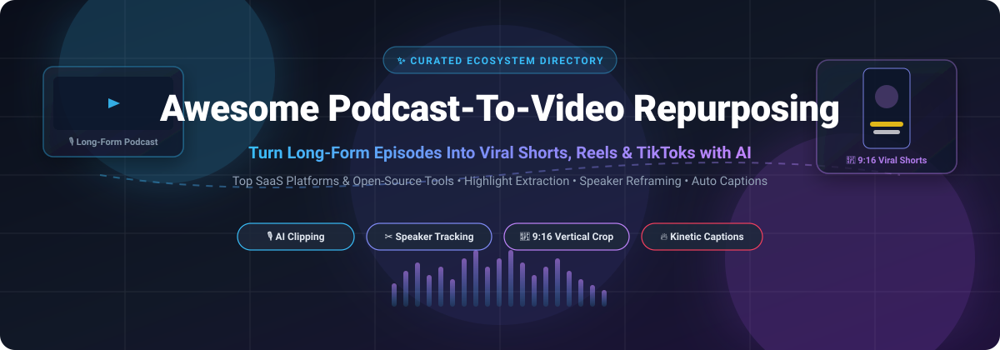
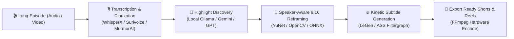

# 🎙️ Awesome Podcast-To-Video Repurposing 🎬

**A curated ecosystem directory of SaaS platforms, AI video clippers, and open-source tools for converting long-form podcast episodes and video streams into viral vertical shorts (YouTube Shorts, TikTok, Instagram Reels).**

 

 

**Last Updated: October 2026** • *Maintained by the Open-Source Creator Community*

---

## 📑 Table of Contents

- [🌟 Overview & SEO Summary](#-overview--seo-summary)
- [📊 Sector Overview & Market Dynamics](#-sector-overview--market-dynamics)
- [🏢 SaaS & Hosted Platforms](#-saas--hosted-platforms)
- [💻 Open-Source GitHub Projects](#-open-source-github-projects)
- [🛠️ Recommended Self-Hosted Stacks](#️-recommended-self-hosted-stacks)
- [🤝 How to Contribute](#-how-to-contribute)
- [⚖️ Disclaimer & Best Practices](#️-disclaimer--best-practices)
- [📈 Star History](#-star-history)
- [💖 Support & Community](#-support--community)

---

## 🌟 Overview & SEO Summary

**Podcast-to-video repurposing** is the automated workflow of converting long-form recordings—such as audio podcasts, video interviews, live webinars, and Twitch/YouTube VODs—into high-engagement, vertical short-form content (9:16 aspect ratio). 

Modern repurposing pipelines eliminate hundreds of hours of tedious manual video editing by combining:
- 🧠 **AI Virality & Highlight Extraction**: Scanning transcripts and audio pitch with LLMs to pinpoint high-retention conversational hooks.
- 🎯 **Speaker-Aware Face Tracking & Reframing**: Dynamically detecting active speakers (using YOLO, YuNet, ONNX, MediaPipe) to convert 16:9 widescreen footage into centered 9:16 vertical video without losing context.
- ⚡ **Automated Transcription & Diarization**: High-speed, word-level speech-to-text with speaker identification powered by OpenAI Whisper, faster-whisper, WhisperX, and Pyannote.
- 🔥 **Kinetic Subtitle Burn-In**: Rendering animated karaoke-style captions (Hormozi style, CapCut style) with custom fonts, emoji triggers, and bounding-box highlights using FFmpeg ASS/SSA filtergraphs.
- 🚀 **Multi-Platform Syndication**: Direct one-click publishing and scheduling across **YouTube Shorts**, **TikTok**, **Instagram Reels**, **LinkedIn**, and **Facebook Reels**.

---

## 📊 Sector Overview & Market Dynamics

The global market for **AI video generation, smart video editing, and automated content repurposing** is estimated between **$1.2 billion and $3.2 billion**, with specialized generative AI video segments expanding at an explosive Compound Annual Growth Rate (**CAGR of 20% to 25%**), projecting past **$9 billion** by the early 2030s.

The podcast and short-form video repurposing ecosystem is **highly fragmented** rather than concentrated in a winner-take-all monopoly:
- **Low Barriers to Entry**: The proliferation of open multimodal APIs (OpenAI Whisper, Claude, Gemini, Deepgram) allows nimble startups to build specialized UI wrappers and niche workflows targeting specific creator personas (streamers, corporate podcasters, solopreneurs, educators).
- **Diverse Strategic Personas**: Mega-platforms (like ByteDance's CapCut and Adobe Premiere) compete for broad consumer mass-market editing, while dedicated mid-market players (Descript, Riverside.fm, Opus Clip) dominate podcast studio ecosystems, and a thriving open-source community provides unlimited, local-first offline alternatives.

---

## 🏢 SaaS & Hosted Platforms

The table below compiles category-leading SaaS video repurposing platforms, ranked in **descending order by company scale** (estimated valuation, funding, and annual recurring revenue).

| 🏢 Platform | 📈 Company Scale (Valuation / Revenue) | 💰 Starting Tier Price | 🎁 Free Tier / Trial Limits | ✨ Key Capabilities & Highlights |
| :--- | :--- | :--- | :--- | :--- |
| **[CapCut](https://www.capcut.com/)** | **Valuation: ~$220B–$480B** *(Parent ByteDance $155B+ Rev; CapCut ARR $100M+)* | **$9.99/mo** *(Web Pro monthly)* or **$7.99/mo** *(billed annually at $89.99/yr)* | **Free forever plan**: Unlimited 1080p exports, basic auto-captions & templates; 1 GB cloud storage; watermark only applies when using Pro-tagged assets. | Full desktop & mobile creator suite with kinetic auto-captions, AI text-to-speech, background removal, template libraries, and direct TikTok publishing. |
| **[Descript](https://www.descript.com/)** | **Valuation: ~$550M** *(Raised $101M; Est. ARR $50M–$100M)* | **$16.00/mo** *(billed annually at $192/yr)* or **$24.00/mo** *(billed monthly)* | **Free forever plan**: 60 minutes of media transcription/month, 100 one-time starter AI credits, 720p maximum export resolution, 5 GB cloud storage. | Text-based document-style audio/video editing, Overdub AI voice cloning, Studio Sound voice isolation, automatic filler word removal, and multicam rough cuts. |
| **[Riverside.fm](https://riverside.fm/)** | **Valuation: ~$300M–$450M** *(Raised $77M; Est. ARR $31.2M)* | **$24.00/mo** *(billed annually at $288/yr)* or **$29.00/mo** *(billed monthly)* | **Free forever plan**: 2 hours lifetime separate multitrack recording, 720p watermarked video export; plus **14-day free trial** on paid plans. | Studio-quality remote podcast recording (separate 4K video + 48kHz WAV audio tracks), AI Magic Clips generator, text-based timeline editing, and social scheduling. |
| **[Opus Clip](https://www.opus.pro/)** | **Valuation: ~$50M** *(Raised $50M+ SoftBank; Est. ARR $10M–$15M)* | **$14.50/mo** *(billed annually at $174/yr)* or **$15.00/mo** *(billed monthly)* | **Free forever plan**: 60 processing credits/month (60 mins raw video), watermarked exports, 9:16 vertical aspect ratio only, 72-hour clip expiration. | Leading AI viral clipping engine; analyzes transcripts for retention hooks, provides automated speaker-tracking vertical reframing, and animated emoji captions. |
| **[Vidyo.ai (Quso.ai)](https://vidyo.ai/)** | **Valuation: ~$25M–$35M** *(Raised $8.8M+; Est. ARR $3.5M)* | **$15.00/mo** *(billed annually at $180/yr)* or **$19.00/mo** *(billed monthly)* | **Free forever plan**: 75 credits/month (75 mins of video), 720p maximum render quality, platform watermark, 7-day clip cloud retention. | Long-to-short video repurposer with AI chaptering, CutMagic scene detection, custom brand templates, animated subtitles, and direct multi-platform scheduling. |
| **[Podcastle (Async)](https://podcastle.ai/)** | **Valuation: ~$15M–$25M** *(Raised $15.3M+; Est. ARR $9.7M)* | **$11.99/mo** *(billed annually at $143.88/yr)* or **$14.99/mo** *(billed monthly)* | **Free forever plan**: 1 hour lifetime transcription, up to 3 hours lifetime video recording, 720p watermarked video export, 160 kbps MP3 export. | Collaborative browser podcast studio with Magic Dust audio cleanup, multitrack recording up to 10 participants, AI text-to-speech voice generation, and audiograms. |
| **[Munch (GetMunch)](https://www.getmunch.com/)** | **Valuation: ~$15M–$25M** *(Raised $7.2M; Est. ARR $2.8M)* | **$38.00/mo** *(billed annually at $456/yr)* or **$49.00/mo** *(billed monthly)* | **7-day free trial**: Includes up to 50 minutes of video processing; no ongoing free-forever tier available. | Trend-aware AI repurposing engine that scans video against social trends, automatically extracts highlight clips, auto-crops to 9:16, and writes social copy. |
| **[Headliner](https://www.headliner.app/)** | **Valuation: ~$10M–$15M** *(Raised $3.5M; Est. ARR $3M–$5M)* | **$7.99/mo** *(billed annually at $95.88/yr)* or **$14.99/mo** *(billed monthly)* | **Free forever plan**: 5 unwatermarked videos/month, 10 mins/month of auto-transcription, unlimited watermarked audiograms and video clips. | Audiogram and waveform generator for podcasters; turns audio into promotional video clips, full-length captioned videos, and automated RSS episode clippers. |
| **[Castmagic](https://www.castmagic.io/)** | **Valuation: ~$5M–$10M** *(Bootstrapped; Est. ARR $1M–$2M)* | **$19.00/mo** *(billed annually at $228/yr)* or **$29.00/mo** *(billed monthly)* | **7-day free trial**: Evaluation credits up to 300 minutes of audio testing; no ongoing free-forever tier available. | Podcast content synthesizer; converts audio recordings into show notes, timestamps, tweet threads, LinkedIn carousels, newsletter blurbs, and clip scripts. |
| **[Klap](https://klap.app/)** | **Valuation: ~$3M–$5M** *(Bootstrapped; Est. ARR $500K+)* | **$14.00/mo** *(billed annually at $168/yr)* or **$29.00/mo** *(billed monthly)* | **1-video free trial**: Allows processing 1 video to generate up to 10 sample short clips (no credit card required); no ongoing free-forever tier. | AI clip generator focused on YouTube Shorts and TikTok; features speaker face tracking, viral moment detection, multi-language dynamic captions, and fast rendering. |

---

## 💻 Open-Source GitHub Projects

For creators and developers who value **data privacy**, **unlimited local processing**, and **zero subscription fees**, these open-source tools run on your local workstation or private cloud GPU. 

The list is sorted in **descending order by GitHub star count**. Each repository includes a live social star badge linking directly to that project's stargazers page:

1. **[auto-editor](https://github.com/WyattBlue/auto-editor)**   
   *Effort-free automated video & audio editing.* Command-line tool that analyzes audio volume and motion to automatically cut out awkward silences, accelerate dead air, and produce preliminary rough cuts for podcasts. Exports project timelines to Adobe Premiere Pro, Final Cut Pro, and DaVinci Resolve.

2. **[AI-Youtube-Shorts-Generator](https://github.com/Anil-matcha/AI-Youtube-Shorts-Generator)**   
   *Open-source alternative to Opus Clip, Vidyo.ai, Klap & Submagic.* Automatically transforms long-form YouTube videos and podcasts into viral 9:16 Shorts using LLM highlight detection, Whisper speech transcription, and automated vertical reframing — completely free with no watermarks or per-clip credit caps.

3. **[auto-subtitle](https://github.com/m1guelpf/auto-subtitle)**   
   *Automated subtitle generator and overlay engine.* CLI utility that leverages OpenAI's Whisper model to transcribe video audio and burns perfectly synchronized subtitles directly onto video files using FFmpeg with customizable styling.

4. **[audiogram](https://github.com/nypublicradio/audiogram)**   
   *Audio-to-video waveform generator by New York Public Radio.* Classic open-source tool for turning audio podcast snippets into shareable videos with dynamic waveform animations, background imagery, and synchronized captions for social media sharing.

5. **[mulmocast-cli](https://github.com/receptron/mulmocast-cli)**   
   *AI-powered podcast & video generator CLI.* Automates the assembly of multi-modal podcast presentations, synchronizing spoken commentary, visual slides, and video layouts directly from script prompts and audio inputs.

6. **[template-audiogram](https://github.com/remotion-dev/template-audiogram)**   
   *Remotion podcast clip template.* Official React-based template for generating high-resolution, programmatic podcast video clips with reactive audio waveforms, burned-in subtitles, and customizable aspect ratios rendered via Remotion.

7. **[LeGen](https://github.com/matheusbach/legen)**   
   *Automated local subtitle studio and translation pipeline.* Uses Whisper and WhisperX for word-level timestamp generation, translates subtitles across dozens of languages, embeds subtitle tracks into MP4 containers, or burns them permanently into videos with GPU acceleration.

8. **[ClippedAI](https://github.com/Shaarav4795/ClippedAI)**   
   *Open-source YouTube Shorts generator and OpusClip alternative.* 100% free and unlimited local video clipper that extracts viral segments from long videos, reframes content, and burns synchronized captions.

9. **[whisply](https://github.com/tsmdt/whisply)**   
   *Cross-platform batch transcription, translation, and speaker annotation.* Highly optimized desktop CLI and GUI that harnesses OpenAI Whisper on CPU, Nvidia CUDA, and Apple Silicon MLX. Generates JSON, SRT, VTT, and speaker-labeled RTTM files completely offline.

10. **[opensource-clipping](https://github.com/NaufalRizqullah/opensource-clipping)**   
    *Ultimate AI Auto-Clipper.* Full-stack pipeline for converting long-form podcast recordings into viral shorts. Includes smart speaker face tracking, kinetic karaoke subtitles, contextual B-roll video overlay, and automated multi-platform uploaders powered by Whisper, MediaPipe, and Gemini.

11. **[n8n-youtube-to-shorts-workflow](https://github.com/mismai-li/n8n-youtube-to-shorts-workflow)**   
    *No-code automated video repurposing workflow.* n8n automation template that downloads long YouTube videos via yt-dlp, extracts viral hooks using LLM analysis, converts them into vertical 9:16 Shorts, and schedules automated posts.

12. **[podcast-shorts-factory](https://github.com/krakonjac300-pixel/podcast-shorts-factory)**   
    *Multi-agent podcast-to-shorts automation system.* Employs cooperating AI agents to ingest long podcast episodes, evaluate virality metrics, re-center speakers, and render batches of ready-to-publish vertical clips offline.

13. **[clips-studio](https://github.com/ColinGPT9/clips-studio)**   
    *Clips Kitty: Local AI video clipper.* Self-hosted alternative to Opus Clip and Klap that ingests Twitch, YouTube, and podcast VODs, identifies highlights with local Ollama LLMs and Whisper, crops to 9:16, and auto-posts 24/7.

14. **[podcli](https://github.com/nmbrthirteen/podcli)**   
    *Open-source MCP server and CLI for podcast clipping.* Transcribes audio using Whisper with word-level timestamps and Pyannote diarization, finds viral moments using Claude or Codex against show show notes, crops to 1080×1920 using YuNet face tracking, and burns styled captions (Hormozi, karaoke, subtle). Includes 17 Model Context Protocol (MCP) tools for Claude Code and Cursor integration.

15. **[murmurai](https://github.com/namastexlabs/murmurai)**   
    *Self-hosted drop-in transcription API replacement.* GPU-powered local speech-to-text service with speaker diarization, word-level alignment, and SRT/VTT/JSON export with zero telemetry.

16. **[cutawan](https://github.com/JeremySNR/cutawan)**   
    *Desktop video clipper for podcasts and long recordings.* MIT-licensed desktop app featuring AI clip discovery via ChatGPT/Codex or OpenAI API keys, local Whisper transcription, speaker-aware reframing with ONNX Runtime, and custom caption burn-in without minute caps.

17. **[Auto-clipper](https://github.com/bendawg2010/Auto-clipper)**   
    *Automated gaming & podcast highlight detection.* Identifies highlights in video VODs using YOLO object detection, pixel motion analysis, and Whisper voice-trigger clipping ("clip that"), with customizable 9:16 vertical exports.

18. **[vid2cc-AI](https://github.com/0xdilshan/vid2cc-AI)**   
    *Video-to-subtitle CLI utility.* Extracts audio tracks via FFmpeg and produces frame-accurate SRT/CC subtitles using local Whisper models with GPU acceleration and private offline processing.

19. **[LocalTranscribe](https://github.com/aporb/LocalTranscribe)**   
    *Offline speaker-labeled audio & video transcription.* Lightweight Python CLI utility that produces multi-speaker diarized transcripts locally with zero external API calls.

20. **[clipify](https://github.com/Siraj-zaki/clipify)**   
    *Turn YouTube podcasts into monetizable 9:16 Shorts.* Full pipeline: `yt-dlp` download → `faster-whisper` transcription → LLM highlight scoring → YuNet face detection & speaker tracking → Hormozi-style ASS captions → one-shot FFmpeg render.

21. **[Surivoice](https://github.com/MozartSoares/Surivoice)**   
    *Local-first speech transcription with speaker diarization.* Combines `faster-whisper` with `pyannote.audio` to produce structured Markdown transcripts with accurate speaker attribution.

---

## 🛠️ Recommended Self-Hosted Stacks

To architect your own **unlimited, zero-cost podcast-to-video repurposing engine**, assemble these open-source building blocks:

- **Full-Pipeline Desktop Clippers**: Use **[AI-Youtube-Shorts-Generator](https://github.com/Anil-matcha/AI-Youtube-Shorts-Generator)**, **[Cutawan](https://github.com/JeremySNR/cutawan)**, or **[Clipify](https://github.com/Siraj-zaki/clipify)**.
- **AI Agent & MCP Integration**: Integrate **[Podcli](https://github.com/nmbrthirteen/podcli)** with Claude Code, Cursor, or Codex.
- **Transcription & Speaker Diarization**: Deploy **[whisply](https://github.com/tsmdt/whisply)**, **[MurmurAI](https://github.com/namastexlabs/murmurai)**, or **[Surivoice](https://github.com/MozartSoares/Surivoice)**.
- **Silence Cutting & Timeline Rough-Cuts**: Run **[auto-editor](https://github.com/WyattBlue/auto-editor)** before clipping.
- **Programmatic Video & Subtitle Rendering**: Build with **[Remotion Audiogram](https://github.com/remotion-dev/template-audiogram)**, **[LeGen](https://github.com/matheusbach/legen)**, or **[auto-subtitle](https://github.com/m1guelpf/auto-subtitle)**.

---

## 🤝 How to Contribute

Contributions are warmly encouraged! To add or update a SaaS tool or open-source project:

1. 🍴 **Fork the repository** on GitHub.
2. 📝 **Add or update the entry** in `README.md` maintaining proper alphabetical or metric sorting.
3. 📌 **Include verified details**: Product name, official link, company valuation/revenue or star badge, specific pricing, and specific free tier limits.
4. 🚀 **Submit a Pull Request** with a brief summary of what was added or updated.

---

## ⚖️ Disclaimer & Best Practices

- ⚖️ **Copyright & Platform Terms**: Always verify intellectual property rights, guest consent, and platform terms of service before clipping and syndicating recorded content.
- 👁️ **Human-in-the-Loop Review**: Automated virality algorithms may occasionally produce false positives or cut critical conversational context. A brief human review is recommended prior to publishing.
- 💻 **Hardware Requirements**: Local open-source models (Whisper, ONNX face tracking, Pyannote diarization) perform best with modern GPU acceleration (Nvidia CUDA with 6GB+ VRAM or Apple Silicon unified memory).

---

## 📈 Star History

---

## 💖 Support & Community

Thank you for exploring and supporting **Awesome-Podcast-To-Video-Repurposing**! If this curated ecosystem directory helps you discover great tools, saves you hours in video editing, or inspires your own content repurposing pipeline:

- ⭐ **Star this repository** to show your appreciation and help fellow creators discover it.
- 🍴 **Fork the project** and submit pull requests with newly discovered tools or updates.
- 📢 **Share it** on Twitter/X, LinkedIn, Discord, and with your creator communities!
- ☕ **Buy me a coffee / Sponsor**: If you'd like to support ongoing curation, research, and maintenance, please consider backing the project via the [GitHub Sponsors Dashboard](https://github.com/sponsors/ishandutta2007).

 

  

